# EUREKA26 — Cybersécurité, IA & Management : connaissez-vous la réalité ?

An interactive, mobile-first audience experience for the **EUREKA26** roundtable: participants answer **10 questions built around real, sourced figures** (Tunisia, international cyberattacks, AI) on their phone; the presenter projects a QR invitation and a TV-grade results dashboard that reveals the real numbers.

The interface is deliberately **minimal in text**: no guide paragraphs; phones show only right/wrong and the real figure; the projected dashboard shows the figure, the correct answer and a short source line. Explanations, caveats and management insights stay available to the presenter behind the `E` key.

**Everything runs on GitHub Pages**: a 100 % static site (Astro + React + Tailwind) — no backend, database, external CDN, analytics or third-party API. All audience-facing text is in French.

| Page | URL (after deployment) | Purpose |
|---|---|---|
| Questionnaire | https://salahgo.github.io/eureka26/ | Mobile quiz for participants |
| QR invitation | https://salahgo.github.io/eureka26/qr/ | Full-screen QR code for the projector |
| Results | https://salahgo.github.io/eureka26/results/ | Presentation dashboard (1920×1080 → 4K) |
| Sources | https://salahgo.github.io/eureka26/sources/ | Methodology, sources, glossary |
| Presenter | https://salahgo.github.io/eureka26/admin/ | Local response collection & remote control |

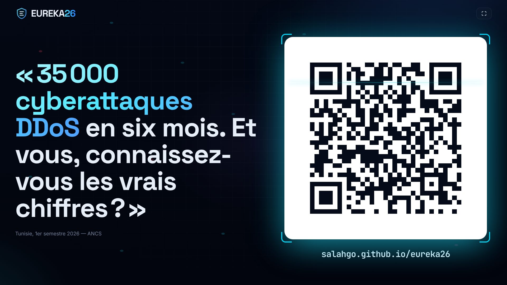

## Screenshots

| Mobile questionnaire | | |
|---|---|---|
| 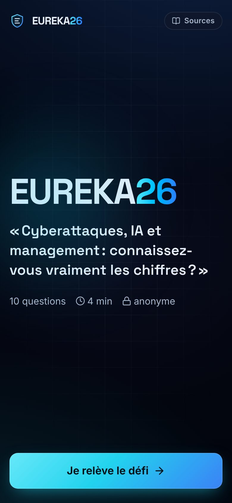 | 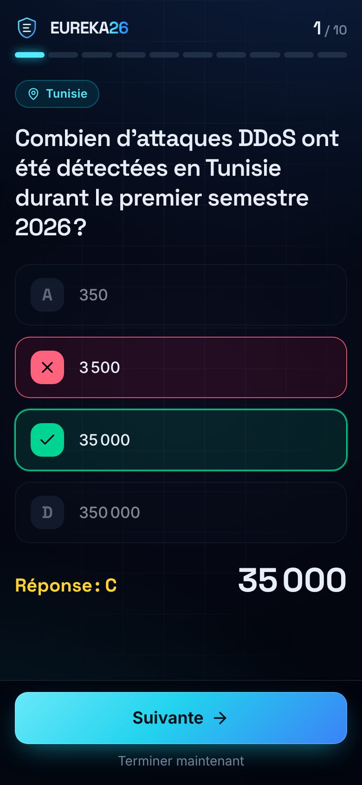 | 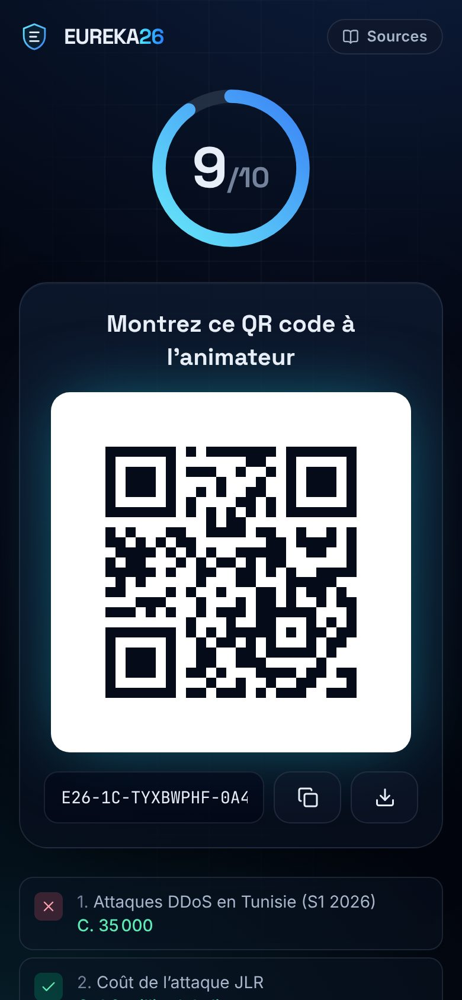 |

| Results dashboard (screens marked *MODE DÉMONSTRATION* use synthetic data) |
|---|
| 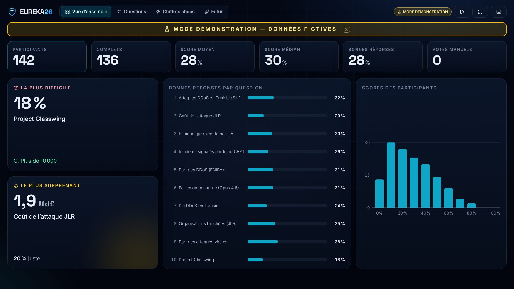 |
| 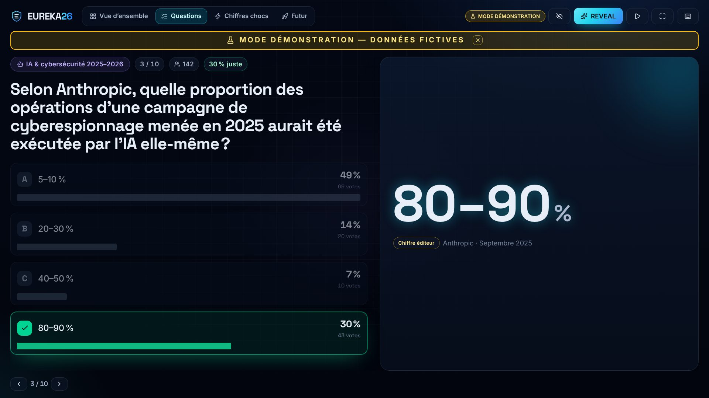 |
| 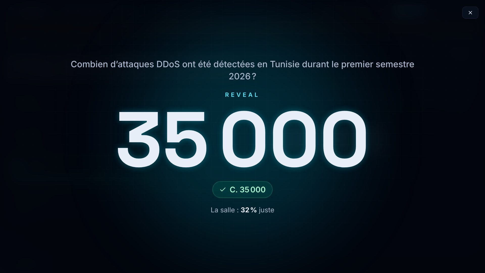 |
| 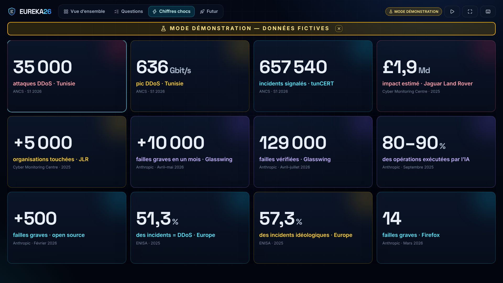 |
| 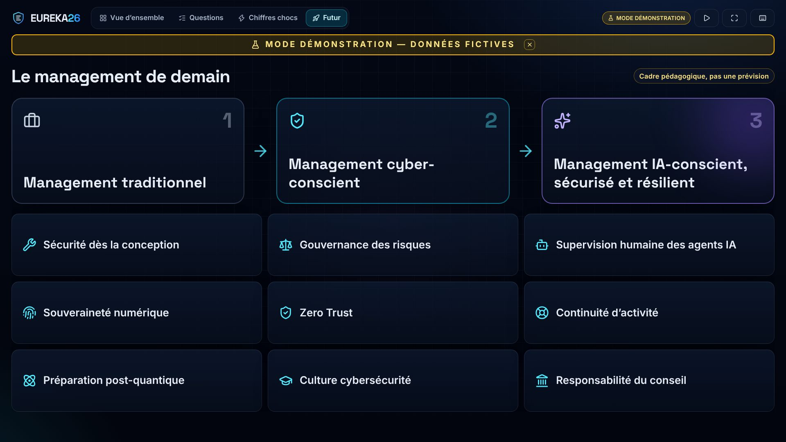 |
| 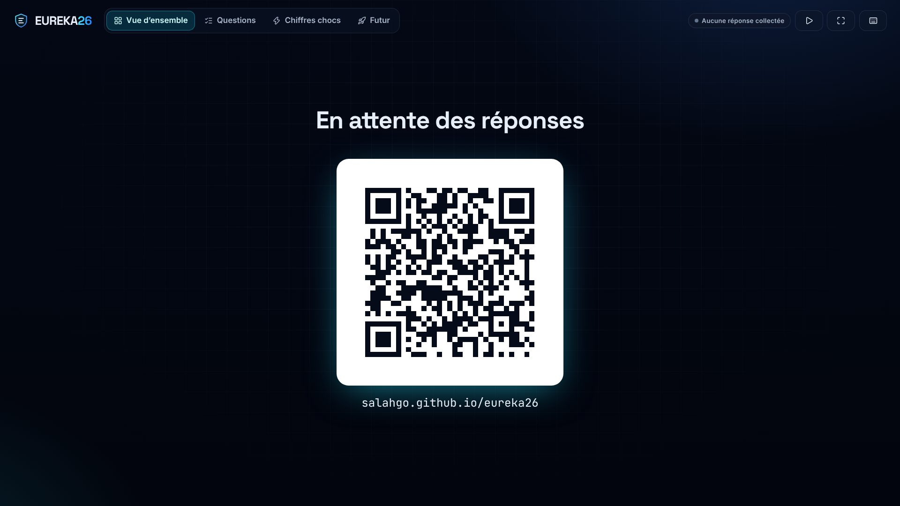 |

| Presenter interface |
|---|
| 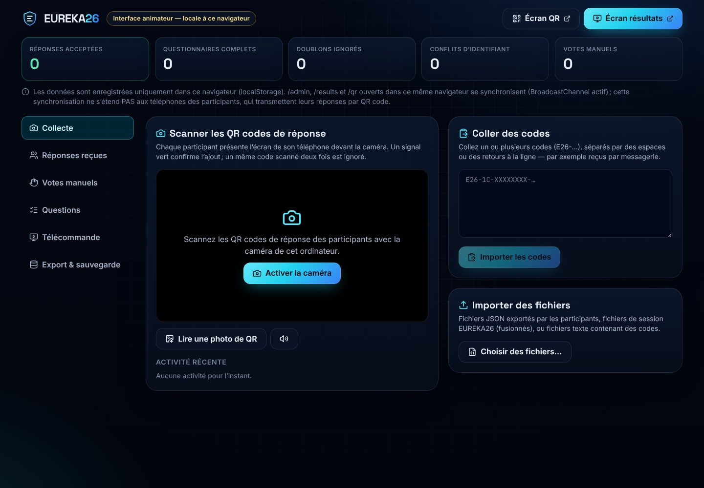 |

More in [`docs/screenshots/`](docs/screenshots/).

## The 10 questions (verified on 16 October 2026)

| # | Figure | Primary source | Notes |
|---|---|---|---|
| Q01 | **35 000** DDoS attacks detected in Tunisia, H1 2026 | [ANCS — S1 2026 statistics](https://www.ancs.tn/fr/statistiques/statistiques-relatives-au-cyberespace-tunisien-1er-semestre-2026) | |
| Q02 | **£1.9 bn** estimated UK impact of the Jaguar Land Rover attack | [Cyber Monitoring Centre](https://cybermonitoringcentre.com/2025/10/22/cyber-monitoring-centre-statement-on-the-jaguar-land-rovercyber-incident-october-2025/) | modelled estimate (range £1.6–2.1 bn), tagged *Estimation* |
| Q03 | **80–90 %** of a 2025 espionage campaign executed by AI | [Anthropic, 13 Nov 2025](https://www.anthropic.com/news/disrupting-AI-espionage) | vendor-reported, tagged *Chiffre éditeur* |
| Q04 | **657 540** incidents reported by tunCERT, H1 2026 | ANCS (same page) | |
| Q05 | **51 %** (51.3 %) of incidents recorded by ENISA were DDoS | [ENISA Threat Landscape 2026](https://www.enisa.europa.eu/sites/default/files/2026-09/ENISA%20Threat%20Landscape%202026_Final.pdf) | 8 257 incidents, calendar year 2025 |
| Q06 | **> 500** high-severity open-source vulnerabilities found by Claude Opus 4.6 | [Anthropic, 5 Feb 2026](https://www.anthropic.com/research/zero-days) | vendor-reported |
| Q07 | **636 Gbit/s** DDoS peak in Tunisia, H1 2026 | ANCS (same page) | |
| Q08 | **> 5 000** UK organisations economically affected by the JLR attack | Cyber Monitoring Centre | affected, not hacked; tagged *Estimation* |
| Q09 | **99.83 %** of tunCERT incidents were “attaques virales” | ANCS (same page) | |
| Q10 | **> 10 000** high/critical vulnerabilities in one month (Project Glasswing) | [Anthropic, 22 May 2026](https://www.anthropic.com/research/glasswing-initial-update) | vendor-reported; Oct 2026 update: [129 000 verified, 33 000+ high/critical](https://www.anthropic.com/news/cyber-verification-program) |

The order alternates Tunisia → international → AI. It can be changed, and questions disabled, in `/admin` (the selection travels to phones through the invitation URL `?s=…`). The *shocking facts* view also shows ENISA's 57.3 % ideology-driven incidents and the 14 high-severity Firefox flaws ([Anthropic / Mozilla, Mar 2026](https://www.anthropic.com/news/mozilla-firefox-security)). Data lives in [`src/data/`](src/data/).

## How audience responses are collected without a backend

GitHub Pages cannot store shared data, so phones are never presented as synchronised:

1. **Participant (phone)** — the quiz runs in the browser; progress is kept in `localStorage`. No name, e-mail or personal data; nothing is sent over the network.
2. At the end the phone shows a **response QR code** and a 26-character code such as `E26-1C-K7F3QX9A-0A5T8B1-D2`: format version, complete/partial flag, an 8-character **random anonymous id**, the answers packed in base 36 and a checksum that rejects tampered or mistyped codes (QR alphanumeric charset → a tiny, easily scanned QR). A JSON download is also offered.
3. **Presenter (`/admin`, projection computer)** collects responses by camera scan (native `BarcodeDetector`, bundled `jsQR` fallback), photo of a QR code, pasted codes, JSON files, or **manually collected votes** (always labelled as such and drawn as a separate bar segment). Repeated anonymous ids are detected and ignored.
4. Aggregation happens **in the presenter's browser only**; `/admin`, `/results` and `/qr` in the **same browser profile** stay in sync through `BroadcastChannel` — never with participants' devices.
5. Exports: aggregated results (CSV/JSON), anonymous individual responses (CSV), full session backup / restore / merge (JSON), and a paginated **QR batch transfer** between devices.

With no responses collected, `/results` still works (correct answers, figures, sources, clear empty state). **MODE DÉMONSTRATION** (key `D`) shows synthetic data under a large banner; it is never stored or exported. `/admin` is a local presenter page, not an authenticated area; its optional PIN only prevents accidental manipulation.

## Presenter keys (`/results`)

| Key | Action |
|---|---|
| `←` / `→` | previous / next question or fact |
| `Espace` | reveal / hide the answer |
| `R` | full-screen **REVEAL** (countdown + animated figure) / fact spotlight |
| `E` | explanation, caveats and management insight (hidden by default) |
| `1`…`4` | overview · questions · shocking facts · future |
| `A` · `F` · `T` · `D` · `?` | slideshow · full screen · data tables · demo mode · help |

## Development

```bash
npm ci
npm run dev          # http://localhost:4321/eureka26/
npm run typecheck
npm test             # unit tests (vitest)
npm run build        # static site in dist/
npx playwright test --project=chromium --project=camera   # E2E (builds, then serves dist/)
npm run screenshots  # regenerates docs/screenshots/
```

`SITE_URL` and `BASE_PATH` override the public origin and base path at build time. The invitation QR code always uses the public URL, never `localhost`.

## Tests

- **Unit (74)**: the 10 questions (verified answers, figure present in the correct choice, sources, glossary, tags), sequence rules, response-code round trip and tamper detection, duplicate/conflict handling, merge/restore, manual votes, aggregation, CSV exports, demo data.
- **End-to-end (39, Chromium)**: every route with direct access and reload, 404, no external request, `lang="fr"`, axe-core WCAG 2 A/AA, JS budget; full quiz at **360/390/430 px** without horizontal scroll and the response **QR decoded back** to the code; persistence; partial completion; `?s=` / `?f=0`; JSON export; paste/duplicate/invalid handling; live `/admin` → `/results` sync; exact aggregation; remote control; manual votes; JSON/photo import; export → reset → restore/merge; batch QR; demo mode never stored; keyboard navigation and REVEAL; full screen; autoplay; 4K layout; production invitation QR decoded to the public URL; and a **real camera scan** through Chromium's fake webcam fed with a generated video of a response QR code.

## Deployment (GitHub Pages)

`.github/workflows/deploy.yml` runs typecheck, unit tests, build and E2E on every push and pull request, and deploys `dist/` to GitHub Pages on pushes to `main`.

One-time setup by a repository admin: **Settings → Pages → Build and deployment → Source: GitHub Actions**, then merge to `main`.
