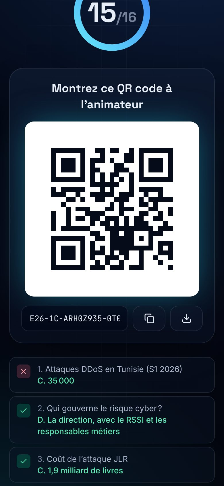

# EUREKA26 — Cybersécurité, IA & Management : connaissez-vous la réalité ?

An interactive, mobile-first audience experience for the **EUREKA26** roundtable on cybersecurity in Tunisia and worldwide, AI-driven attacks, cyber governance and the future of management. Participants answer a fast quiz on their phone; the presenter projects a QR invitation and a TV-grade results dashboard that reveals the real, sourced figures.

The interface is deliberately **minimal in text**: no guide paragraphs, no explanations or management insights on phones (only right/wrong and the real figure), and on the projected dashboard only the figure, the correct answer and a short source line. Explanations, caveats, glossary terms and the management insight of each question stay available to the presenter behind the `E` key.

**Everything runs on GitHub Pages**: a 100 % static site (Astro + React + Tailwind), no backend, no database, no external CDN, no analytics, no third-party API. All audience-facing text is in French.

| Page | URL (after deployment) | Purpose |
|---|---|---|
| Questionnaire | https://salahgo.github.io/eureka26/ | Mobile quiz for participants |
| QR invitation | https://salahgo.github.io/eureka26/qr/ | Full-screen QR code for the projector |
| Results | https://salahgo.github.io/eureka26/results/ | Presentation dashboard (1920×1080 → 4K) |
| Sources | https://salahgo.github.io/eureka26/sources/ | Methodology, sources, glossary |
| Presenter | https://salahgo.github.io/eureka26/admin/ | Local response collection & remote control |


## Screenshots

| Mobile questionnaire | | |
|---|---|---|
|  |  |  |

| Results dashboard (screens marked *MODE DÉMONSTRATION* use synthetic data) |
|---|
|  |
|  |
|  |
|  |
|  |
|  |

| Presenter interface |
|---|
|  |

More in [`docs/screenshots/`](docs/screenshots/).

## How audience responses are collected without a backend

GitHub Pages cannot store shared data, so the experience never pretends that phones are synchronised. The flow is:

1. **Participant (phone)** — the quiz runs entirely in the browser; progress is saved in `localStorage` (survives reloads). No name, e-mail or personal data is requested and nothing is sent over the network.
2. At the end the phone shows a **response QR code** and a copyable code such as `E26-1C-K7F3QX9A-0T004LVZ9EX9TPY5-V8`:
   - `1` format version, `C`/`P` complete or partial, an 8-character **random anonymous id**,
   - the answers packed in base 36 (one base-5 digit per question: none / A / B / C / D),
   - a 2-character checksum that rejects tampered or mistyped codes.
   It uses only the QR *alphanumeric* charset (35 characters → a very small, easily scanned QR). The participant can also download a JSON file.
3. **Presenter (`/admin`, projection computer)** collects responses by:
   - scanning response QR codes with the computer's **camera** (native `BarcodeDetector` when available, bundled `jsQR` otherwise),
   - reading **photos/screenshots** of QR codes,
   - **pasting** one or many codes (e.g. received by messaging),
   - importing **JSON files** (participant exports or whole sessions),
   - entering **manually collected votes** (show of hands) — always labelled as such and drawn as a separate bar segment.
   Repeated anonymous ids are detected: an identical code is ignored as a duplicate; a different payload with the same id is flagged as a conflict (a complete version replaces a partial one).
4. Aggregation happens **in the presenter's browser only**. `/admin`, `/results` and `/qr` opened in the **same browser profile** stay in sync through `BroadcastChannel` (with `storage` events as fallback). This does **not** reach other devices.
5. The presenter can export aggregated results (CSV/JSON), individual anonymous responses (CSV), and back up / restore / merge the whole session (JSON). A paginated **QR batch transfer** moves collected codes from one device (e.g. a phone used as a roaming scanner) to the projection computer, still without a server.

If no responses were collected, `/results` still works: correct answers, explanations, sourced statistics and a clearly labelled empty state. A **MODE DÉMONSTRATION** (key `D`) generates synthetic data for rehearsals: it is shown with a large banner, never stored and never exported.

The `/admin` page is a **local presenter interface, not an authenticated area**. An optional local PIN only prevents accidental manipulation on the presentation computer; it is not security.

## Presenter guide

1. Before the event, open `/admin` → **Questions**: keep the default 16-question sequence or choose/reorder a subset (the selection travels to phones through the invitation URL `?s=…`, so fix it *before* projecting the QR code). Optionally disable per-question corrections on phones (`?f=0`).
2. Project `/qr` (key `F` for full screen).
3. When participants finish, scan their response QR codes in `/admin` → **Collecte** (green flash = accepted, amber = duplicate, red = invalid). The running total is always visible.
4. Project `/results` in another window of the same browser and drive it from the keyboard or from `/admin` → **Télécommande**.

| Key | Action |
|---|---|
| `←` / `→` | previous / next question, fact or section |
| `Espace` / `Entrée` | reveal / hide the answer |
| `E` | explanation, caveats and management insight (hidden by default) |
| `R` | dramatic full-screen **REVEAL** (countdown + animated figure) / fact spotlight |
| `1`…`5` | overview · questions · shocking facts · management · future |
| `O` | back to overview |
| `A` | automatic slideshow |
| `F` | full screen |
| `T` | data tables (accessibility) |
| `D` | MODE DÉMONSTRATION |
| `?` | help |

## Question bank

- **29 questions** (the 22 from the brief + 7 complementary ones on digital sovereignty, Zero Trust, PAM, AI-agent governance, the Tunisian 2026 cybersecurity circular, GRC and post-quantum migration).
- **16 used by default**, alternating: Tunisian statistic → management concept → international attack → AI breakthrough → geopolitics/sovereignty → Tunisian statistic… The full order is configurable in `/admin` and in [`src/data/questions.ts`](src/data/questions.ts) (`DEFAULT_SEQUENCE`, `FULL_SEQUENCE`).
- Each question has an id, category, difficulty, four choices, correct answer, explanation, reporting period, source(s), abbreviations, management insight, and — where relevant — caveats (estimates, vendor-reported figures) and a *now vs. projection* split.

### Verification of numerical claims (checked on 16 October 2026)

| # | Claim | Primary source | Status |
|---|---|---|---|
| Q1 | 35 000 DDoS attacks detected, H1 2026 | [ANCS — S1 2026 statistics](https://www.ancs.tn/fr/statistiques/statistiques-relatives-au-cyberespace-tunisien-1er-semestre-2026) | ✅ |
| Q2 | Peak 636 Gbit/s | same | ✅ |
| Q3 | 657 540 incidents declared by tunCERT | same | ✅ |
| Q4 | 99.83 % “attaques virales” | same | ✅ |
| Q5 | Groupe CRIT confirms a data leak at its Tunisian subsidiaries (22 May 2026) | [Groupe CRIT communiqué](https://www.groupe-crit.com/infos/commu/Groupe_Crit_Fuite_de_Donnees_Crit_Tunisie.pdf) | ✅ (ransomware claim by “Titan” unverified, stated as such) |
| Q6 | 114 digital-transformation projects in progress (Aug 2026) | [Présidence du gouvernement via La Presse](https://www.lapresse.tn/2026/08/15/tunisie-114-projets-numeriques-en-cours-voici-les-services-qui-vont-bientot-changer-le-quotidien/) | ✅ |
| Q7 | DDoS = 51.3 % of incidents | [ENISA Threat Landscape 2026](https://www.enisa.europa.eu/sites/default/files/2026-09/ENISA%20Threat%20Landscape%202026_Final.pdf) | ✅ |
| Q8 | Public administration ≈ one third | same | ✅ **corrected**: 31.8 % of recorded incidents (brief said “32 % of targeted organisations”) |
| Q9 | Ideology-driven = 57.3 % | same | ✅ |
| Q10 | JLR: £1.9 bn estimated UK impact (range £1.6–2.1 bn) | [Cyber Monitoring Centre](https://cybermonitoringcentre.com/2025/10/22/cyber-monitoring-centre-statement-on-the-jaguar-land-rovercyber-incident-october-2025/) | ✅ labelled as a modelled estimate |
| Q11 | > 5 000 UK organisations affected | same | ✅ economically affected, not hacked |
| Q12 | AI executed 80–90 % of a 2025 espionage campaign | [Anthropic, 13 Nov 2025](https://www.anthropic.com/news/disrupting-AI-espionage) | ✅ vendor-reported |
| Q13 | > 10 000 high/critical vulnerabilities (Project Glasswing) | [Anthropic, 22 May 2026](https://www.anthropic.com/research/glasswing-initial-update) | ✅ **dated**: one month after launch; Oct 2026 update (129 000 verified / 33 000+ high-critical) added |
| Q14 | > 500 high-severity vulnerabilities, Claude Opus 4.6 | [Anthropic, 5 Feb 2026](https://www.anthropic.com/research/zero-days) | ✅ vendor-reported |
| Q15 | 14 of 22 Firefox vulnerabilities rated high | [Anthropic](https://www.anthropic.com/news/mozilla-firefox-security) / [Mozilla](https://blog.mozilla.org/en/firefox/hardening-firefox-anthropic-red-team/), 6 Mar 2026 | ✅ |
| Q16–Q20, Q24, Q25, Q28 | DDoS, MCP, SOAR/SIEM/SOC, RTO/RPO, NIST CSF 2.0 GOVERN, Zero Trust, PAM, GRC | NIST, MCP spec, Anthropic, OWASP… (see `/sources`) | ✅ definitions |
| Q22, Q29 | ML-KEM / ML-DSA (FIPS 203/204, Aug 2024); NIST IR 8547 *draft* 2030/2035 timeline; NCSC 2028/2031/2035 milestones | [NIST](https://www.nist.gov/news-events/news/2024/08/nist-releases-first-3-finalized-post-quantum-encryption-standards), [NIST IR 8547 ipd](https://csrc.nist.gov/pubs/ir/8547/ipd), [NCSC](https://www.ncsc.gov.uk/guidance/pqc-migration-timelines) | ✅ projections labelled as such |
| Q27 | Tunisian circular n° 5 of 2 Sept 2026 (MFA, disabled inactive accounts…) | [Tunisie Numérique](https://www.tunisienumerique.com/la-cheffe-du-gouvernement-publie-une-circulaire-pour-renforcer-la-cybersecurite-des-structures-publiques/), Agence Ecofin | ✅ |

Not used on purpose: the ANCS “336 security advisories” (the page's own monthly chart sums to 366) and any H1-2026-vs-2025 comparison (the period of the ANCS “2025” page is not stated). Full notes on [`/sources`](https://salahgo.github.io/eureka26/sources/).

## Tech stack

- [Astro 7](https://astro.build/) static output (`build.format: 'directory'`, `base: '/eureka26'`) with React 19 islands (`client:only`) and Tailwind CSS 4.
- Fonts bundled from `@fontsource-variable/*` (Inter, Space Grotesk, JetBrains Mono); icons from `lucide-react`.
- QR generation: `uqr` (SVG rendered by our own component). QR scanning: `BarcodeDetector` → `jsqr` fallback (lazy-loaded).
- Charts are hand-built SVG/HTML (single-series, colour palette validated for colour-vision deficiencies; table view with `T`).
- Persistence: `localStorage`; same-browser sync: `BroadcastChannel`.

```
src/
  data/        questions.ts (29 questions, sequences) · sources.ts · glossary.ts · facts.ts
  lib/         codec.ts (response codes) · session.ts (ingest, duplicates, merge) · aggregate.ts
               exporters.ts (CSV/JSON) · config.ts (presenter config & presentation state) · sync.ts
  components/  quiz/ · qr/ · results/ · admin/ · common/
  pages/       index · qr · results · sources · admin · 404
tests/
  unit/        vitest — question bank, codec, ingest/aggregation/exports
  e2e/         Playwright — routes, a11y (axe), mobile quiz, presenter sync, camera scan, screenshots
```

## Development

```bash
npm ci
npm run dev          # http://localhost:4321/eureka26/
npm run typecheck
npm test             # unit tests (vitest)
npm run build        # static site in dist/
npx playwright test --project=chromium --project=camera   # E2E (builds, then serves dist/)
npm run screenshots  # regenerates docs/screenshots/
```

`SITE_URL` and `BASE_PATH` environment variables override the public origin and base path at build time (custom domain, fork). The invitation QR code always uses the public URL, never `localhost`; `/admin` lets the presenter override it.

## Testing

- **Unit (127 tests)**: every question is complete (4 distinct choices, correct index, explanation, insight, period, https source, glossary entries), all reference answers match, sequences respect the pacing rules, abbreviations expand to official terms, codes round-trip and reject tampering, duplicate/conflict detection, merge/restore, manual votes, aggregation (mean, median, hardest question, histogram), CSV escaping, deterministic demo data.
- **End-to-end (39 tests, Chromium)**: direct access + reload of every route (with and without trailing slash), 404, no external network request, `lang="fr"`, axe-core WCAG 2 A/AA (no serious/critical violations), JS budget; full questionnaire at **360/390/430 px** with no horizontal scroll and the response **QR decoded back** to the code; persistence after reload; partial completion; `?s=`/`?f=0`; participant JSON export; presenter paste/duplicate/invalid handling; live sync `/admin` → `/results`; exact aggregation; remote control; manual votes; JSON/photo import; export → reset → restore/merge; batch-transfer QR; demo mode never stored; keyboard navigation, REVEAL animation, facts spotlight; full screen; autoplay; 4K layout; production invitation QR decoded to the public URL; and a **real camera scan** using Chromium's fake webcam fed with a generated Y4M video of a response QR code.

## Deployment (GitHub Pages)

`.github/workflows/deploy.yml` runs typecheck, unit tests, the static build and the E2E suite on every push and pull request, and deploys `dist/` to GitHub Pages on pushes to `main`.

One-time setup by a repository admin: **Settings → Pages → Build and deployment → Source: GitHub Actions**. Then merge to `main` (or run the workflow manually on `main`).

## Privacy & limitations

- No personal data is collected; response codes contain a random id and A/B/C/D choices only.
- Phones are never synchronised with the presenter: answers reach the dashboard only when the presenter scans/imports them.
- Results live in the presenter's browser; clearing site data deletes them — export a session backup.
- Camera scanning needs HTTPS (GitHub Pages) and the browser's permission; image import, paste and manual votes remain available otherwise.
